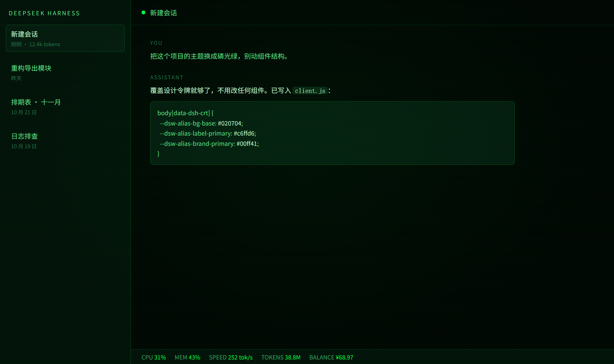
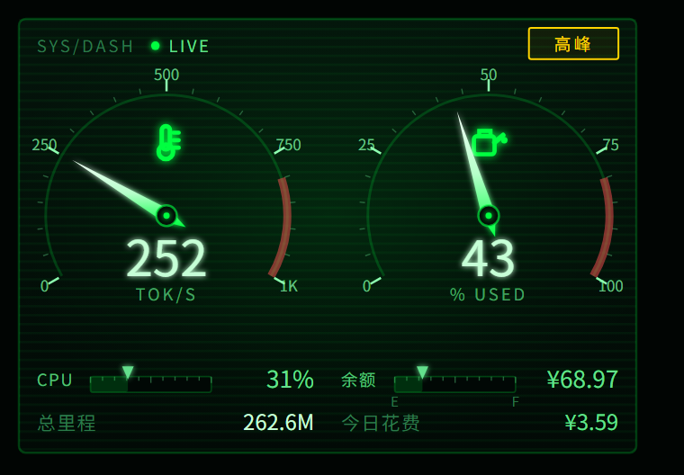

# dsh-crt-theme

A CRT terminal skin for [DeepSeek Harness](https://github.com/deepseek-ai/deepseek-harness): phosphor green on near-black, scanlines, monospace type.



## Dashboard

A gauge widget in the sidebar footer: output speed, memory use, CPU, DeepSeek balance and token totals for the day.



## Install

```sh
dsh plugin --profile <your-profile> add github:kinglhy2006/dsh-crt-theme
```

Restart the profile or reload the page. Remove it with `dsh plugin --profile <your-profile> remove dsh-crt-theme`.

## What it does

- Repaints the conversation and sidebar by overriding the host's design tokens. No component is patched or replaced.
- Dashboard in the sidebar footer: output speed and memory on two gauges, CPU, session and lifetime tokens, today's spend, and a peak / off-peak badge for DeepSeek's off-peak pricing.
- Status line above the input: link state, output speed, memory use and balance at a glance.
- Balance is shown as fuel — 300 on the dial is full. Below 15% it turns yellow, below 5% red.
- Optional DeepSeek account balance. The key is read in the host process and never reaches the browser.

## Balance readout (optional)

Create `~/.dsh/deepseek-balance.json`:

```json
{ "api_key": "sk-..." }
```

Or set `DSH_BALANCE_CONFIG` to a JSON file with the same shape. The key is sent only to `https://api.deepseek.com/user/balance`. The file is plain text — keep normal file permissions on it.

## Tests

```sh
node test/smoke.mjs
```

## 中文

给 DeepSeek Harness 用的 CRT 终端皮肤：近黑底磷光绿、扫描线、等宽字体，只覆盖设计令牌，不改组件结构。侧栏底部带一个仪表盘（输出速度、内存、CPU、余额、token），可选显示 DeepSeek 余额。

## License

MIT
